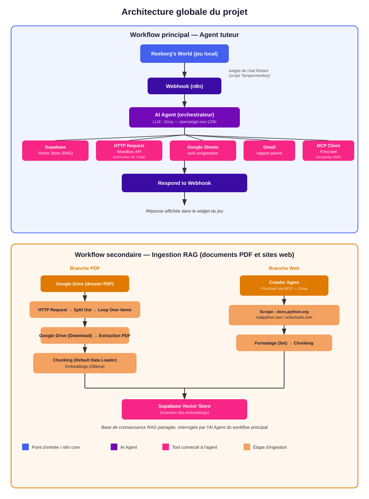

## 📖 Présentation du projet:
Ce projet propose un agent IA tuteur de Python, intégré sous forme de widget de chat directement dans Reeborg's World, un jeu éducatif open source où l'élève programme un robot en Python (déplacements, boucles, conditions) pour résoudre des labyrinthes.
L'élève joue, écrit du code Python dans l'éditeur du jeu, et peut demander de l'aide au tuteur IA en temps réel via un chat superposé à l'interface du jeu. L'agent comprend la nature de la demande (question de cours, debug de code, demande d'indice, suivi de progression) et choisit automatiquement le bon outil pour y répondre, via une architecture n8n orchestrant un LLM, un système RAG, plusieurs services externes, une API d'exécution de code et un outil de web scraping.
Toutes les briques du workflow ont été testées et validées en conditions réelles directement depuis Reeborg's World, via un widget de chat injecté dans l'interface du jeu.
Ce projet a été réalisé dans le cadre d'une formation réalisée au sein de l'Orange Digital Center, visant à démontrer l'orchestration d'IA, de données, d'APIs et de services tiers au sein d'un seul système automatisé avec n8n.

## 🧩 Points techniques utilisés :
| Composant | Technologie |
|---|---|
| Orchestration | n8n |
| AI Agent | n8n AI Agent (LangChain) |
| LLM Provider | Groq (`openai/gpt-oss-120b`) |
| RAG | Supabase Vector Store (pgvector) |
| Embeddings | Ollama (`nomic-embed-text`, exécution locale) |
| Documents RAG | PDF (Google Drive, ingestion en boucle) |
| Exécution de code | Wandbox API |
| Suivi de progression | Google Sheets |
| Notifications | Gmail |
| Web scraping | Firecrawl (via MCP Client) |
| Jeu éducatif | Reeborg's World (exécution locale, serveur HTTP simple) |
| Pont jeu ↔ workflow | Widget de chat JS (Tampermonkey) + Webhook n8n |

## 🏗️ Architecture globale :

## 🎥 Démonstration :
Une vidéo de démonstration complète est disponible ici :

La vidéo montre :

1.Présentation du cas d'usage.

2.Vue d'ensemble du workflow dans n8n

3.Exécution en direct depuis Reeborg's World

4.Vérification des résultats (Supabase, Google Sheets, boîte Gmail)
